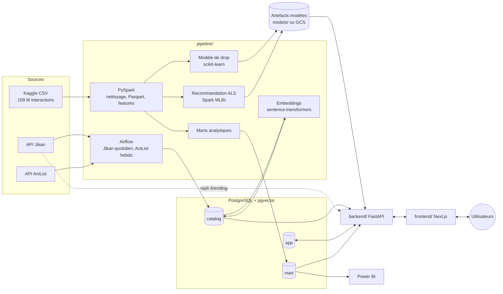

# Architecture — Tsuzuku

## Schémas Postgres

- **catalog** : œuvres, genres, tags, embeddings, stats quotidiennes Jikan
- **app** : comptes, listes et choix d'onboarding des utilisateurs Tsuzuku (tables `users`,
  `list_entry`, `onboarding_choice`), créés et modifiés **uniquement** par les migrations Alembic
  de l'API ; `catalog` et `mart` appartiennent au pipeline ([ADR 008](decisions/008-comptes-et-listes.md))
- **mart** : agrégats analytiques produits par Spark (courbes de drop, rétention, runs de modèles)

Détail des tables : [SPEC.md § 5](SPEC.md).

Les métadonnées d'Airflow (runs, états des tâches) vivent dans une base séparée, `airflow`, sur
le même serveur Postgres.

## Ingestion (phase 6)

- **`jikan_daily_ingest`** (tous les jours, 06:00 UTC) : saison en cours + watchlist (API Jikan)
  → `catalog.media` (nouveaux animes) et `catalog.media_daily_stats` (une ligne par anime et par
  jour, colonne `in_season`).
- **`anilist_catalog_sync`** (le lundi, 05:00 UTC) : titres les plus populaires d'AniList →
  `catalog.media` (manga, manhwa, manhua), `catalog.media_genre`, `catalog.media_tag`, puis
  couvertures manquantes des animes par idMal (tâche `anime_covers`, phase 8).
- Chaque tâche écrit d'abord la réponse brute dans `data/raw/<source>/<date>/`, puis charge par
  upsert ; un rapport de contrôle va dans `reports/ingestion/`.
- **`/trending`** lit le dernier snapshot de `catalog.media_daily_stats` (saison seulement) ;
  appel direct à Jikan seulement en repli (snapshot absent ou trop ancien).
- L'embedding des nouvelles œuvres (flèche `catalog → Embeddings`) arrive en phase 10.

Choix et limites : [ADR 007](decisions/007-airflow-ingestion.md).

## Front (phase 8)

- Le navigateur ne parle qu'à `frontend/` (Next.js), qui relaie `/api/*` vers `backend/` :
  même origine, cookie de session `httpOnly` envoyé tout seul, pas de CORS.
- Accueil rendu côté serveur (sections en streaming) ; pages de compte côté navigateur
  (TanStack Query). `proxy.ts` renvoie vers la connexion sans cookie ; l'API reste seule juge.
- Tokens et composants : [DESIGN.md](DESIGN.md). Choix et limites : [ADR 009](decisions/009-front-next.md).
