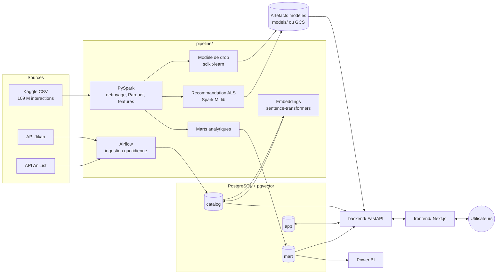

# Architecture — Tsuzuku

## Schémas Postgres

- **catalog** : œuvres, genres, tags, embeddings, stats quotidiennes Jikan
- **app** : comptes et listes des utilisateurs Tsuzuku
- **mart** : agrégats analytiques produits par Spark (courbes de drop, rétention, runs de modèles)

Détail des tables : [SPEC.md § 5](SPEC.md).
